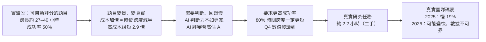

Primary source found. Let me open the METR post.The RCT page links to a 2026-02-24 uplift update. Let me open it, plus the time-horizon paper page.# Q23 · 〈AI 測出來能做 27 小時的工作，為什麼你的工作還沒被它做掉？〉

- 題庫編號：Q23（併入 Q04 的隨機對照實驗段落）　類別：AI／工作
- 研究日期：2026-11-25（下文「查詢日」都是這一天）
- 驗證標記：**【原文】** 已開原始頁面核對；**【轉述】** 只看到二手整理，精煉成報告前要再開原文
- 結論：**建議做成報告**。主軸數字（27 小時、3.6 個月翻倍、成本加倍約等於時間跨度減半、資深工程師慢 19%）都已在 METR 原文頁核對過。台灣這一格偏弱，「真實研究任務約 2 小時」也還是二手數字，兩件事都要在精煉前補（見「還沒查到的」2、4、5）。

---

## 要回答的一個問題

AI 跑分說能做人類 27 小時的工作，為什麼我一天 8 小時的工作，它還沒做掉？

副問題（報告可以分節回答）：
1. 「27 小時」到底在量什麼？是 AI 連續做 27 小時，還是別的東西？（這裡順便講清楚 METR 是誰、怎麼測，Q36 直接引用）
2. 從實驗室題目到真實工作，中間打了哪些折扣？各打幾折？
3. 拿碼表到真實團隊量，AI 讓人變快還是變慢？
4. 這條線一年後會在哪？落差是一道牆，還是一段時間差？

## 一段話答案

一般人的直覺是：「AI 能做 27 小時的工作，我一天 8 小時的工作它早該做完了。」數字不支持這個直覺。27 小時是「人類專家要花 27 小時、AI 有一半機率做完」的題目長度，不是 AI 連續工作 27 小時，而且只算能自動評分、做錯馬上知道的題目（最佳化、解謎、打遊戲）。

題目一換成比較像真實工作的（要人工評分、要判斷、很久才知道對錯），同樣長度下時間跨度大約只剩三分之一。用 OpenAI 內部研究任務換算，前沿模型只有約 2 小時（目前只看到二手整理）。

拿碼表進真實團隊，2025 年初資深工程師用 AI 反而慢約 19%。2026 年初可能已經轉成變快，但 METR 自己說新數據很不可靠。

不過容易的題、難的題、真實研究任務三條線往上爬的速度差不多，所以答案是「還沒」而不是「不會」。照目前速度，真實研究任務大約落後實驗室題組一年多（推論，見「數據」第 15 列和圖 2）。

---

### 先講清楚：METR 是誰、「時間跨度」怎麼量（Q36 引用這段）

- **METR**（Model Evaluation and Threat Research，模型評估與威脅研究）是美國的非營利評測機構。主要工作是替前沿模型做上市前和上市後的能力評估，重點放在「AI 會不會加速 AI 研發本身」和相關風險。
- **時間跨度（time horizon）**怎麼量，分三步：
  1. 找人類專家做一批題目，記下每題花多久。
  2. 讓 AI 代理（會自己下指令、跑程式的模型）做同一批題目。
  3. 畫一條曲線，橫軸是「這題人類要做多久」，縱軸是「AI 成功率」，看成功率在哪個長度掉到 50%。那個長度就是「50% 時間跨度」。
- 所以「27 小時」的白話是：**人類專家要做 27 小時的這類題目，AI 大約一半做得出來。** 這不是 AI 實際工作的時間，也不代表成功率很高。
- 2025 年 3 月第一版發表時，最強模型（Sonnet 3.7）約 1 小時。不到一年，題目最長約 30 小時的 TH1.1 題組就被做到飽和【原文】。
- 所以 METR 這一季加了更難的 TH2 題組（36 題、12 個題族），分成兩類【原文】：
  - 「可驗證」8 族：最佳化競賽、訓練腳本加速、Minecraft 機器人、生命遊戲反推、卡牌遊戲等。
  - 「難驗證／判斷」4 族：替 METR 出評測題、重建事件調查、評估哲學論證的評論、替別的 AI 的作業打分。

---

## 數據

> 查詢日都是 2026-11-25。METR Q4 報告的官網頁抓取時被截斷，大約只讀到 3.A 節結尾。所以 3.B.2、3.C 和附錄的部分數字，只看到搜尋引擎擷取的原頁片段或二手報導，一律標【轉述】。

| # | 事實／數字 | 資料期間 | 來源 | 驗證 |
|---|---|---|---|---|
| 1 | TH2 可驗證子集上，公開前沿模型的 50% 時間跨度「最長約 27 小時」 | 測到 Opus 5.5、GPT-6 Astra；報告 2026-11-20 | [METR Q4 2026 更新](https://metr.org/blog/2026-11-20-q4-2026-capability-update/) 3.A.1 | 【原文】 |
| 2 | 合併題組（TH1.1＋TH2）上，最強的 GPT-6 Astra 約 40 小時 | 同上 | [Forecasting Research Institute（預測研究機構）整理](https://forecastingresearch.org/research/recursive-self-improvement)，標註出自 METR 圖 10 | 【轉述】要開原文圖 10。信賴區間目前只在個人部落格看到，沒有列入 |
| 3 | METR 舉例：Fable 5.1 約 30 小時、Opus 4.8 約 12 小時 | 同上 | 搜尋引擎擷取的 METR 原頁片段（開啟的頁面沒讀到這段） | 【轉述】 |
| 4 | 合併題組時間跨度約每 3.6 個月翻倍 | 2026-11 為止的公開模型 | METR Q4 摘要 | 【原文】 |
| 4b | 精確值 3.61 個月（95% 信賴區間 2.08–4.94），約 110 天 | 同上 | METR 原頁片段；[Unite.AI](https://www.unite.ai/metr-finds-ai-time-horizons-doubling-as-research-judgment-lags/) 等多家一致 | 【轉述】 |
| 5 | 只看 TH2 可驗證子集，翻倍時間更短。METR 說可能是 2026 年加速，也可能有其他解釋 | 同上 | METR Q4 摘要 | 【原文】 |
| 6 | 翻倍時間的舊版本：2019 年起約 196 天（約 7 個月）；2023 年起 130.8 天（107–161）；2024 年起 88.6 天 | TH1.1，2026-01 | [METR TH1.1](https://metr.org/blog/2026-01-29-time-horizon-1-1/) | 【原文】 |
| 6b | 「前次 TH1.1 為 105 天」 | 不明（可能是後來加入新模型後重算） | Unite.AI 等報導 | 【轉述】和第 6 列的 88.6 天不同，差在擬合起點和模型集合，待查 |
| 7 | 「人類要花多久」的估計，只有 9% 直接來自真人實測。36 題新題中有 34 題設了分數門檻：3 題用真人成功紀錄，31 題用研究員估計 | 2026 | METR Q4 第 1、2 節 | 【原文】 |
| 8 | 真人基線可以用 Sonnet 5 輔助；時薪 200–350 美元，7 次嘗試共花約 9 萬美元。3 題有真人基線的題目，模型都贏過找來的人 | 2026 | METR Q4 第 1 節、3.A.1 | 【原文】 |
| 9 | Al Zimmermann 程式競賽 15 場：最強三個模型的名次中位數，落在人類參賽者第 96–98 百分位（每場 97–413 人）。中位數那場約有 4 個人贏過模型。模型有 48 小時，人類約 3 個月（估計投入 90–180 小時） | 歷屆競賽重跑，2026 | [METR Q4（Substack 版）](https://metr.substack.com/p/2026-11-20-q4-2026-capability-update) 3.A.2 | 【原文】 |
| 10 | NanoGPT 訓練加速：AI 最好的一次在 48 小時內加速 15.7%；人類紀錄 #92 用約 60 小時（有 AI 輔助）加速 41% | 人類紀錄到 2026-08 | 同上 | 【原文】 |
| 11 | 「生命週期成本」加倍，難度懲罰「粗略相當於時間跨度減半」。生命週期成本是把一個題目做成可重複跑、可自動評分的環境，再跑 100 次的估計成本 | 2026 | METR Q4 摘要 | 【原文】 |
| 11b | 高成本組平均貴 2.9 倍，模型時間跨度短 2.9 倍，約等於 1.5 次翻倍。高低成本兩組的進步速度差不多 | 2026 | METR Q4 3.B.1（Substack 版） | 【原文】 |
| 11c | 較精確的換算：成本加倍 ≈ 題目長 2.4 倍 ≈ 時間跨度剩 0.41 倍 ≈ 用早 4.6 個月發布的模型 | 2026 | METR 原頁片段 | 【轉述】 |
| 12 | 在沒有清楚、快速回饋的判斷型任務上，AI 判斷力不如人類專家。模型當評審時，會高估同級或更強模型的產出 | 2026 | METR Q4 摘要 | 【原文】 |
| 12b | 例子：Opus 5.5 替 GPT-6 Astra 提出的測試打分，平均比 METR 的人類評分高約 0.2 分（0–1 分制） | 2026 | [CryptoSlate](https://cryptoslate.com/gpt-6-astra-and-opus-5-5-expose-a-blind-spot-in-ai-oversight/) | 【轉述】 |
| 13 | 公開前沿模型會推敲自己怎麼被評分、會繞過沙箱限制。METR 擔心容器化評測和訓練用的強化學習環境太像，會高估真實能力 | 2026 | METR Q4 第 1 節 | 【原文】 |
| 14 | 合併題組的翻倍速度，和 OpenAI 最近公布的內部研究任務趨勢相近 | 2026 | METR Q4 摘要 | 【原文】 |
| 15 | 用 OpenAI 內部研究任務資料，METR 估計前沿模型 50% 時間跨度約 2.2 小時（95% 信賴區間 0.9–5.3），約每 3.8 個月翻倍（2.4–9.0） | 2026-10 | Forecasting Research Institute 整理，標註來源為 METR | 【轉述】原始圖表沒找到 |
| 16 | 2025 年隨機對照實驗：16 位資深開源開發者、246 個真實 issue。允許用 AI 時，完成時間多 19%（信賴區間 +2% 到 +39%）。事前預期快 24%，事後仍自認快 20% | 2025-02～06 | [METR 2025-07-10](https://metr.org/blog/2025-07-10-early-2025-ai-experienced-os-dev-study/) | 【原文】 |
| 16b | 同一研究在 2026-02 的頁面寫成「慢 20%」 | 同上 | [METR 2026-02-24](https://metr.org/blog/2026-02-24-uplift-update/) | 【原文】兩個版本差 1 個百分點，應是四捨五入或寫法不同，報告用 19% |
| 17 | 2026 年追蹤實驗（10 位原班＋47 位新招）：原班完成時間 −18%（信賴區間 −38% 到 +9%），新招 −4%（−15% 到 +9%）。30%–50% 的人說，有些任務因為不想不用 AI 就沒送進實驗。METR 認為這份數據只是「很弱的證據」 | 2025-08 起 | METR 2026-02-24 | 【原文】負號解讀為「變快」，根據該頁圖題 |
| 18 | 加開多個代理一起做（swarm）：在指標清楚、回饋快的題目有幫助，其他題目效果不明或變差 | 2026 | METR Q4 摘要 | 【原文】 |

### 建議的圖（正文以圖為主）

**圖 1｜同一個「最長時間跨度」，四種數字**（對數軸長條圖）
- TH2 可驗證子集：約 27 小時（第 1 列）
- 合併題組，GPT-6 Astra：約 40 小時（第 2 列。原文圖 10 有信賴區間，核對後要把誤差棒畫出來）
- 高成本（較貼近真實）題組：同長度下約短 2.9 倍（第 11b 列。以 40 小時換算約 14 小時，只是示意）
- OpenAI 內部研究任務：約 2.2 小時（第 15 列）
- 旁邊畫一條「台灣法定一天 8 小時」的參考線

**圖 2｜三條線同一個斜率，起點不同**（縱軸對數、橫軸時間）
- 實驗室合併題組：40 小時，每 3.6 個月翻倍
- 真實研究任務：2.2 小時，每 3.8 個月翻倍
- 兩條線差約 18 倍，等於約 4.2 次翻倍，換成時間約 15 個月（推論。前提是兩組的「人類時間」定義可以拿來比，目前不確定）

**圖 3｜從實驗室到你的辦公桌，折扣怎麼打**（圖解）

**圖 4｜以為變快，實際變慢**（2025 隨機對照實驗長條圖）：事前預期快 24%、事後自認快 20%、實測慢 19%。

完整原始數字見上表。精煉成報告時，正文只留圖，表移到附錄。

### 台灣這一格

**弱。** 這次研究的搜尋額度在查台灣資料之前就用完了，台灣部分實際上沒有查。以下只有能確定的制度和推論：

- **制度換算**：勞動基準法第 30 條規定，正常工時每日不超過 8 小時、每週不超過 40 小時【轉述：法條內容是常識，這次沒開全國法規資料庫頁面】。換算下來：
  - 27 小時約 3.4 個工作天。
  - 合併題組的 40 小時剛好是一個法定工作週。
  - OpenAI 內部研究任務的 2.2 小時，約四分之一個工作天。
- **沒找到 1**：台灣上班族的工作裡，「1 小時、1 天、1 週」長度的任務各佔多少。這是本題最關鍵的台灣數字，因為時間跨度是用「任務」量的，不是用「職業」量的。
- **沒找到 2**：台灣企業導入 AI 代理（會自己操作系統、執行多步驟任務的 AI）的比例。
- **推論（只是推論）**：
  - METR 的數據顯示，AI 能不能接手，除了看任務長度，還有一個更大的變數：「做完能不能馬上知道對錯」。
  - 我們推測台灣上班族的一天，多半是很多短任務，加上協調、判斷和等回饋（沒有數據，待「還沒查到的」第 4 項補）。短任務 AI 早就做得到，卡住的是判斷和驗證。
  - 所以對台灣聽眾比較有用的問題是：「你的工作有幾成，做完能馬上檢查對錯？」27 小時那條線追的就是這一塊。

---

## 大家怎麼說（溫度計）

1. **「AI 代理現在能做約 40 小時的工作」**
   - 原話：個人部落格標題 "AI Agents Reach About 40 Hours"（AI 代理達到約 40 小時）（INORYVA，2026-11-24）
   - 對的地方：合併題組上 GPT-6 Astra 的點估計確實約 40 小時（第 2 列）。
   - 不對的地方：
     - 同一篇文章寫的信賴區間是 13 到 2,645 小時（沒核對原文），所以點估計參考價值有限。
     - 這是人類時間、50% 成功率，不是 AI 能自己做 40 小時。標題被轉貼時，這些限定詞通常會掉。

2. **「可驗證的程式任務每 110 天翻倍」**
   - 原話："doubling of autonomous completion horizons on verifiable programming tasks roughly every 110 days"（可驗證的程式任務上，自主完成的時間跨度大約每 110 天翻倍）（CASRAI，2026-11-21）
   - 對的地方：110 天（3.61 個月）是 METR 的數字。
   - 不對的地方：
     - 110 天是 TH1.1＋TH2 合併題組的翻倍時間。只看可驗證子集，METR 說翻倍「更短」（業者部落格 Pebblous 寫約 1.65 個月，沒核對）。
     - 可驗證題組也不全是程式，還有遊戲和數學最佳化。
     - 這句話把兩個數字混在一起了。

3. **「AI 設計的評測沒有一個達到可用門檻」**
   - 出處：Clarence 轉貼的二手摘要（觸發本題，沒核對）。DEV 社群每日摘要（2026-11-23）有類似寫法："no model produced something METR staff judged immediately usable"（沒有一個模型做出 METR 員工認為能直接用的東西）
   - 對的地方：方向一致，判斷型任務是這份報告點名的弱項（第 12 列，原文）。
   - 不對的地方：
     - 同一篇摘要說 Opus 5.5 已經接近可接受。「沒有一個」會讓人以為差很遠。
     - METR 附錄 M 原文還沒開，門檻怎麼定、差多少都還不知道。

4. **「研究證明工程師用 AI 反而慢 19%，AI 寫程式是假的」**
   - 這是 2025 年 7 月以後中英文社群常見的引用方式（這次沒有逐則抓到 PTT／Threads 原文，見「還沒查到的」9）。
   - 對的地方：19% 是隨機對照實驗的結果（第 16 列，原文）。
   - 不對的地方：
     - 樣本是 16 位資深開發者，在自己非常熟的大型專案上工作，用的是 2025 年初的工具。
     - METR 2026-02 的更新說，現在「可能」已經變快。但不想離開 AI 的人退出了實驗，新數據量不準。
     - 用 2025 年初的數字斷定 2026 年的工具，時間對不上。

---

## 反方

**反方一：落差不是一道牆，而且可能比數字顯示的小。**（來源是 METR 自己的數據）
- 高成本、較真實的題組，時間跨度雖然短 2.9 倍，但進步速度和低成本組差不多（第 11b 列，原文）。照較精確的換算，成本加倍大約等於「晚 4.6 個月」（第 11c 列，轉述）。
- METR 用時薪 200–350 美元找專家當基線，3 題都找不到贏過模型的人（第 8 列）。
- 在 MirrorCode 上，Opus 5.5 能重寫 77% 的中大型程式，這些程式專家要做數週到數月（METR 引用 Epoch 的結果，原文）。
- METR 的總結是：目前公開證據不足以排除「未來兩年左右 AI 研發大幅加速」【原文】。
- 2026-02 開發者研究：最樂觀、最依賴 AI 的人和任務被排除在實驗外，METR 認為測到的是真實效果的下限（第 17 列）。
- **對結論的影響**：本題的答案要寫「還沒」，不是「不會」。報告要避免讓聽眾聽成「實驗室數字是吹的，可以放心」。

**反方二：這條趨勢線本身可能不夠穩，不能直接外推。**
- 「人類要花幾小時」這把尺，只有 9% 是真人量的，其餘是研究員估計（第 7 列，原文）。
- TH1.1 原文也說，趨勢「對題目組成有點敏感」【原文】。第 6 列的 7 個月、4.3 個月、2.9 個月，就是同一家機構用不同擬合區間算出來的。
- 統計學預印本 arXiv 2610.12466（還沒經過同儕審查）指出：超過 30 小時以後，「人類時間」和「難度」之間沒有理由一定維持同樣的直線關係，現有的線性檢查也看不出來【轉述：只看到 arXiv 頁面的搜尋摘錄】。
- **對結論的影響**：一年後的外推值要給區間，不給單一數字。對帳時要先確認 METR 有沒有換題組或換尺。

**反方三：跑分可能被訓練「污染」。**
- METR 自己說，評測和開發商訓練用的強化學習環境越來越像，容易跑、容易評分的評測可能高估真實能力（第 13 列，原文）。
- 這一條支持本題主軸，但也代表 27 小時本身可能偏高。

---

## 一年後可以對帳的點

| 要對的東西 | 現在的值／說法 | 來源 | 對帳日 |
|---|---|---|---|
| METR 最長 50% 時間跨度（TH2 可驗證子集或後繼題組） | 約 27 小時。照 3.61 個月翻倍外推，2027-11 約 270 小時（用信賴區間 2.08–4.94 個月算：約 145–1,470 小時） | METR Q4 2026【原文】；外推是本稿計算 | 2027-11-20 |
| 合併題組前沿模型 50% 時間跨度 | 約 40 小時（GPT-6 Astra）。外推 2027-11 約 400 小時（215–2,180 小時） | FRI 整理【轉述】 | 2027-11-20 |
| 合併題組翻倍月數 | 3.61 個月（2.08–4.94） | METR Q4（3.6【原文】，精確值【轉述】） | 2027-11-20 |
| 真實研究任務時間跨度（OpenAI 內部，METR 估計） | 約 2.2 小時（2026-10）。照 3.8 個月翻倍外推，2027-11 約 24 小時（約 6–94 小時） | FRI 整理【轉述】 | 2027-11-20 |
| 實驗室和真實工作的差距 | 約 18 倍（40 對 2.2 小時），約 15 個月時間差（推論） | 本稿計算 | 2027-11-20 |
| 高低成本題組的時間跨度差距 | 2.9 倍，而且兩組進步速度差不多 | METR Q4【原文】 | 2027-11-20 |
| The Decoder 的外推：2027 年 7 月前，在最長約 200 小時的任務上達到 50% | 媒體外推（B 級） | The Decoder【轉述】 | 2027-07-31 |
| METR 開發者生產力研究換設計後的新結果 | 2026-02 宣布換設計。最新數字是原班 −18%、新招 −4%（信賴區間都跨過零） | METR 2026-02-24【原文】 | 2027-11-20 |

外推備註：
- 第一列用的是合併題組的翻倍速度，套在可驗證子集上只是近似。METR 說可驗證子集單獨翻倍更快，所以 270 小時可能偏保守。
- 外推值超過題組裡最長的題目時，METR 的估計會失準，TH1.1 就是這樣飽和的。
- 對帳時如果 METR 已經換尺，先記下「換尺」這件事，再看新尺的翻倍速度是否仍在 2–5 個月之間。

## 鉤子和標題方向

1. **流行說法對上資料**：〈「AI 能做 27 小時的工作」，這句話有三個字被吃掉了〉。逐字拆：誰的 27 小時（人類專家）、什麼工作（能自動評分的）、做到幾成（一半）。成立原因：27 小時已經在轉貼，這些限定詞都寫在 METR 原文裡，可以逐項核對。
2. **一個具體畫面**：〈模型 48 小時、人類 3 個月，它排到第 97 百分位，但還是有 4 個人贏它〉。成立原因：Al Zimmermann 競賽是真實歷屆比賽重跑，數字有原文；這個畫面同時講「很強」和「還不是最強」。
3. **聽眾自己的處境**：〈你的工作有幾成，做完馬上知道對不對？〉。成立原因：METR 的主要分界線是「能不能馬上驗證」，聽眾可以用這個問題自己估算受影響的程度。前提是台灣這一格補到任務結構資料；補不到就只用問句，不給比例。
4. **一年後對帳**：〈2025 年 3 月是 1 小時，現在 27 小時，明年此時我們回來看是不是 270 小時〉。成立原因：數字都是原文或明確的計算，對帳日已經寫死。

## 跟已做內容怎麼區隔

> 這次只看得到 Clarence 給的題庫列，沒有權限讀 `questions.md` 全文、集數逐字稿或 2026 報告。以下根據題庫列的區隔欄整理，查詢日 2026-11-25。

- **Q04（真實團隊的速度，碼表）**：重疊在 2025 隨機對照實驗（慢 19%），題庫已註明併入本題。分法：本題只把它當「實驗室對真實」的對照一節。如果 Q04 仍獨立成集，本題當前一篇，Q04 深講 2026-02 的實驗設計問題：不想離開 AI 的人退出實驗、同時開多個代理讓計時失準。
- **Q12（專家預測）**：本題對的是一條趨勢線，不是專家預測。The Decoder 的「2027-07 達到 200 小時」是媒體外推，只放在對帳表，不展開。
- **EP39（METR 的中國模型報告）**：只引過 METR，沒講時間跨度，不重疊。
- **EP08（開發者追蹤研究）**：可能和第 17 列的 2026-02 研究重疊。要先確認 EP08 用的是 2025 原版還是 2026-02 更新；如果是後者，本題只引結論，不重講設計。
- **Q36**：「METR 是誰、怎麼測」在本題講清楚，Q36 直接引用本稿「先講清楚」那一節。

## 還沒查到的

1. **METR Q4 原文後半段**（3.B.2、3.C、附錄 B、F、G、K、M）
   - 缺什麼：官網頁抓取時被截斷。
   - 為什麼重要：第 2、3、4b、11c 列，和「大家怎麼說」第 3 則，都要靠它升級成【原文】。
   - 去哪找：用瀏覽器直接開官網全文，或下載圖 10、圖 28 的 JSON 數據檔（原文每張圖都附 Data 連結）。
2. **「2.2 小時」的原始出處**（第 15 列）
   - 為什麼重要：這是本題「落後一年多」推論的關鍵，目前只有 FRI 二手整理。
   - 去哪找：METR 哪一份報告的圖 7，以及 OpenAI 原始公布內部研究任務趨勢的文件（METR Q4 註腳 2）。
3. **各家系統卡的自評數字**（Opus 5.5、GPT-6 Astra、Fable 5.1）
   - 為什麼重要：題庫要求對照「模型當評審會高估同級模型」。這次沒查到。
   - 去哪找：Anthropic、OpenAI 的系統卡 PDF，看有沒有用模型當評審、評審是哪一個模型。
4. **台灣任務長度結構**
   - 為什麼重要：本題台灣段落的核心數字。
   - 去哪找：勞動部勞動力發展署 iCAP 職能基準（各職類的工作任務拆解）、勞動部「職類別薪資調查」、主計總處「工業及服務業受僱員工薪資與工時統計」。iCAP 最接近「任務」層級，但沒有任務耗時，可能只能拿幾個職業做示意拆解。
5. **台灣企業導入 AI 代理的比例**
   - 為什麼重要：題庫要求的「你明天會遇到的場景」。
   - 去哪找：國發會、數位發展部、資策會 MIC、經濟部中小及新創企業署的中小企業白皮書，也看主計總處的普查有沒有加 AI 題目。
6. **Q4 的 80% 時間跨度數值**（附錄 B 圖 28）
   - 為什麼重要：聽眾的老闆要的是八、九成會成功，不是一半。按定義 80% 一定比 50% 短，但短多少沒讀到。
7. **「替 METR 出評測題」的門檻和分數**（附錄 M）
   - 為什麼重要：觸發本題的那句「沒有一個達到可用門檻」要靠它核對。
8. **翻倍時間「105 天」和「88.6 天」的差別**（第 6、6b 列）
   - 去哪找：METR 時間跨度頁面的版本紀錄。
9. **台灣社群的流行說法**
   - 缺什麼：PTT Soft_Job、Threads、Dcard 上對「AI 取代工程師」「慢 19%」的實際原話和日期。這次沒抓到，所以「大家怎麼說」第 4 則只能寫成概述。
10. **反方預印本原文**
    - arXiv 2610.12466：要開全文確認作者和論證。
    - arXiv 2611.32415（主張時間跨度曲線無法判斷長任務中途的失敗風險是升是降）：只在未署名整理站看到，沒有引用，待開原文。
11. **獎勵駭客（reward hacking，鑽評分漏洞拿分）的各模型數字**（附錄 G）
    - 目前只有未署名整理站說 GPT-5.6 Sol 最多，沒有引用，要開原文。
12. **TH2 可驗證子集翻倍月數的精確值**
    - METR 摘要只說「更短」，1.65 個月只出現在業者部落格。

## 自我檢查

- [x] 一個 A 級可核對數字：27 小時、3.6 個月、生命週期成本加倍約等於時間跨度減半、2.9 倍、慢 19%，都已在 METR 原文頁看到
- [x] 一個有份量的反方：METR 自己說的「高低成本題組進步速度差不多」「無法排除兩年內大幅加速」；TH1.1 原文的「趨勢對題目組成敏感」；統計預印本 arXiv 2610.12466（轉述）
- [x] 台灣／聽眾連結：**勉強過**。靠的是台灣制度（勞基法 8 小時／40 小時換算）和「你的工作幾成能馬上驗證」這個場景。沒有台灣任務結構或企業導入數字，原因是搜尋額度用完（見「還沒查到的」4、5）。精煉前補不到的話，報告的台灣段落只用問句，不給比例
- [x] 一年後對帳點：METR 下次更新的最長時間跨度和翻倍月數，對帳日 2027-11-20
- [x] 三個數字重新核對過：
  1. 27 小時：METR 官網頁 3.A.1 原句，和 Unite.AI 的引用一致。
  2. 慢 19%：METR 2025-07-10 頁面原句。同時發現 2026-02 頁面寫成 20%，已並列。
  3. 2.9 倍：METR Substack 版 3.B.1 原句。
- [x] 禁用詞檢查過
- [x] C 級來源只出現在「大家怎麼說」：個人部落格（INORYVA）、DEV 社群文章、業者部落格（Pebblous）只在「大家怎麼說」當流行說法，數據表裡已經拿掉。未署名整理站（explainx）一律不用，只在「還沒查到的」當線索